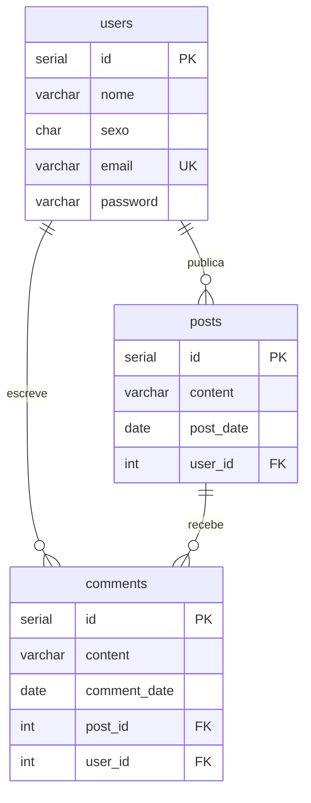

# Facebook CRUD — TWII Atividade 1

Projeto Java Web (Servlets + JSP + JSTL) da disciplina **Tecnologias de Desenvolvimento para Internet II** (IFSULDEMINAS — Campus Machado), usando **PostgreSQL** como banco de dados.

## O que foi implementado

| Cadastro | Rotas | Observações |
|---|---|---|
| Usuários | `/users`, `/users/save`, `/users/update`, `/users/delete` | Projeto base |
| **Posts** | `/posts`, `/posts/form`, `/posts/save`, `/posts/update`, `/posts/delete` | CRUD completo; usuário do post escolhido em um `<select>` |
| **Comentários** (botão `?`) | `/comments`, `/comments/form`, `/comments/save`, `/comments/update`, `/comments/delete` | Novo cadastro; FK para `posts` e `users`, ambos escolhidos em `<select>` |

Cada cadastro segue o mesmo padrão do cadastro de Usuários: **tabela → entidade → DAO (interface + implementação) → Controller → páginas JSP** (listagem e formulário).

```
db/schema.sql                         Script do banco (tabelas + dados iniciais)
src/main/java/model/                  Entidades: User, Post, Comment
src/main/java/model/dao/              DAOs, DAOFactory, DBHandler, ConnectionFactory
src/main/java/controller/             Servlets: Login, Users, Posts, Comments + AuthFilter
src/main/webapp/                      JSPs, CSS e JS (Bootstrap)
```

## Como rodar

Pré-requisitos: **Docker**, **JDK 17+** e **Maven 3.8+**.

```bash
docker compose up -d   # sobe o PostgreSQL 16 e cria as tabelas (db/schema.sql)
mvn jetty:run          # sobe a aplicação
```

Acesse **http://localhost:8080/facebook** e entre com `admin@facebook.com` / `admin123`.

Para parar: `Ctrl+C` na aplicação e `docker compose stop` no banco. Para zerar o banco: `docker compose down -v` (o schema roda de novo no próximo `up`).

## Modelo do banco



As chaves estrangeiras usam `ON DELETE CASCADE`: excluir um usuário remove os posts e comentários dele; excluir um post remove os comentários do post.

## Alterações em relação ao projeto base

- **MySQL → PostgreSQL**: driver `org.postgresql`, `ConnectionFactory` com variáveis de ambiente, `CURDATE()` → `CURRENT_DATE`, `INSERT` com colunas nomeadas; os DAOs foram renomeados para `PostgreSQL*DAO`.
- **Maven** (`pom.xml`): as dependências (driver JDBC, JSTL) agora vêm do Maven em vez de jars em `WEB-INF/lib`.
- **Vazamento de conexões corrigido**: o `DBHandler` não fechava a conexão nas consultas; agora é `AutoCloseable` e os DAOs usam `try-with-resources`.
- **Edição de usuário**: deixar a senha em branco mantém a senha atual (antes ela era trocada pelo hash de uma senha vazia, o que impedia o login).
- **Login**: adicionado o `return` que faltava após redirecionar com campos vazios.
- Encoding UTF-8 nas requisições (`web.xml`) para acentos funcionarem nos formulários.
# projeto_hemerson_outubro
